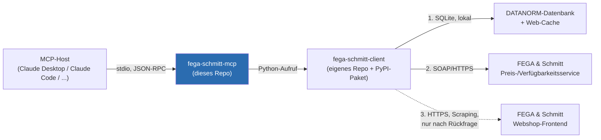

# fega-schmitt-mcp

[](https://github.com/the78mole/fega-schmitt-mcp/actions/workflows/publish.yml)
[](LICENSE)
[](https://github.com/astral-sh/uv)
[](https://github.com/astral-sh/ruff)

> **Status:** Artikelsuche und -abfrage über DATANORM und SOAP, Preis-/Verfügbarkeitsabfrage
> (SOAP) sowie Webshop-Zugriff mit Rückfrage beim User implementiert, noch nicht auf PyPI
> veröffentlicht.

Ein **dünner** [MCP](https://modelcontextprotocol.io)-Server, der KI-Assistenten (z. B. Claude)
Zugriff auf Daten von **FEGA & Schmitt Elektrogroßhandel** gibt. Er nutzt die Quellen in dieser
Reihenfolge:

1. **DATANORM** — lokale SQLite-Datenbank aus der DATANORM-Lieferung (`fega datanorm import`):
   Artikelstammdaten, EAN, Herstellernummern, Warengruppen sowie Listen-/Nettopreis der letzten
   Lieferung. Kein Request.
2. **SOAP-Preisservice** — tagesaktueller Preis, Zuschläge und Verfügbarkeit.
3. **Webshop** — nur für das, was die beiden anderen nicht liefern (Bilder, technische Attribute,
   Zubehör/Varianten, Shop-Kategorie, eigene Artikelnummer, Schnittkosten, Warenkörbe,
   Bestellungen, Aktionen), und **nur nach Rückfrage beim User** (siehe
   [Webshop-Freigabe](#webshop-freigabe)).

Die gesamte Protokoll-/API-Logik (DATANORM, SOAP, Auth, Fehlercodes, XML, Webshop-Scraping) lebt **nicht**
in diesem Repo, sondern in der eigenständigen Python-Library
[`fega-schmitt-client`](https://github.com/the78mole/fega-schmitt-client)
(Repo unter `GIT/Python/`, auf [PyPI](https://pypi.org/project/fega-schmitt-client/) veröffentlicht).
Dieses Repo bildet nur die Brücke zwischen MCP-Protokoll und dieser Library.



> **Suchst du die Python-Library oder das CLI-Tool?**
> Siehe [`fega-schmitt-client`](https://github.com/the78mole/fega-schmitt-client) — die
> eigenständige Library, die dieser MCP-Server verpackt.

## Warum zwei Pakete?

- **`fega-schmitt-client`**: reine Python-Library, kein MCP-/KI-spezifischer Code. Eigenständig
  nutzbar (Skripte, andere Services), unabhängig testbar, unabhängig versionierbar.
- **`fega-schmitt-mcp`** (dieses Repo): übersetzt die Library-Funktionen in MCP-Tools
  (stdio-Transport, Tool-Schemas, Fehler-Serialisierung für MCP-Clients). Enthält selbst keine
  SOAP-/XML-Logik.

## Tools

### Artikelsuche und -abfrage (DATANORM → SOAP → Webshop)

| Tool | Beschreibung |
|------|-------------|
| `search_articles` | Sucht in DATANORM: Artikelnummer, EAN und Herstellernummern exakt (diese Treffer zuerst), sonst Artikel, deren Kurztexte alle Suchwörter enthalten. Nur ohne DATANORM-Treffer wird — nach Rückfrage — der Webshop durchsucht. Jeder Treffer nennt `source` (`datanorm`/`web`) und das passende Feld (`matched`). |
| `get_article` | Alles zu einem Artikel: DATANORM-Stammdaten und -Preise (je `price_unit`), heutiger Preis/Verfügbarkeit per SOAP und Webshop-Daten. Shop-Daten aus dem Cache (max. 30 Tage alt) kommen ohne Rückfrage mit; `include_web=true` lädt fehlende Shop-Daten nach Rückfrage, `refresh_web=true` ignoriert den Cache. Fehlschläge einzelner Quellen stehen in `warnings`. |

### SOAP-Preisservice

| Tool | Beschreibung |
|------|-------------|
| `get_price_availability` | Preis und Verfügbarkeit für bis zu 999 Artikel je Anfrage. Eingabe: Liste von Artikelnummern mit Menge und optionaler Mengeneinheit. Ausgabe je Artikel: Verfügbarkeitsstatus, Nettopreis, Listenpreis, Zu-/Abschläge, Lagerzuordnung. Fehlerfälle (unbekannte Artikelnummer, ungültige Mengeneinheit, Mengenüberlauf) werden je Position gemeldet, ohne die gesamte Anfrage abzubrechen. |

### Webshop (best-effort, nicht offiziell dokumentiert, nur nach Rückfrage)

Diese Tools sprechen die Kunden-Weboberfläche (`shop.fega.de`) statt einer dokumentierten
Schnittstelle an — siehe [`fega-schmitt-client`/docs/extensions.md](https://github.com/the78mole/fega-schmitt-client/blob/main/docs/extensions.md)
für Details/Vorbehalte je Methode. Nutzen dieselben Zugangsdaten wie `get_price_availability`.
Jeder Aufruf fragt vorher den User (siehe [Webshop-Freigabe](#webshop-freigabe)). Suche und
Artikeldetails laufen über `search_articles`/`get_article`; die früheren Tools
`web_search_articles` und `web_get_article` gibt es nicht mehr.

| Tool | Beschreibung |
|------|-------------|
| `web_set_article_number` | Eigene (kundenspezifische) Artikelnummer für einen Artikel setzen; verwirft den Cache-Eintrag des Artikels. |
| `web_get_cable_lengths` | Verfügbare Kabellängen (Trommeln/Reststücke) eines Kabelartikels je Lagerstandort. |
| `web_list_articles_by_category` | Artikel einer UWG-Warengruppe auflisten. |
| `web_get_favorites` | Gespeicherte Favoritenliste abrufen. |
| `web_get_deal_campaigns` | Aktive Aktionsangebote-Kampagnen auflisten. |
| `web_get_deal_articles` | Artikel einer Aktionsangebote-Kampagne abrufen. |
| `web_get_daily_deals` | Tagesangebote abrufen. |
| `web_get_second_choice_articles` | "2. Wahl"/B-Ware-Artikel abrufen. |
| `web_get_cart` | Inhalt eines Warenkorbs (Standard: aktuell aktiver) abrufen. |
| `web_get_cart_list` | Alle Warenkörbe des Kunden auflisten. |
| `web_get_order_list` | Bestellübersicht abrufen. |
| `web_get_order` | Positionen einer einzelnen Bestellung abrufen. |

## Webshop-Freigabe

Bevor der Server einen Request an den Webshop schickt, fragt er den User:

- **Client mit Elicitation** (z. B. Claude Code): Der Server zeigt selbst eine Ja/Nein-Rückfrage
  mit dem Zweck des Zugriffs. Beim 2025er Handshake-Protokoll geschieht das per
  `elicitation/create` während des Aufrufs, ab Protokoll 2026-07-28 per `InputRequiredResult`
  (der Client fragt und wiederholt den Aufruf mit der Antwort). Nur ein „Ja" gibt den Zugriff
  frei; `allow_web` kann eine Ablehnung nicht überstimmen.
- **Client ohne Elicitation**: Das Tool antwortet mit `web_confirmation_required: true`. Das
  Modell muss den User im Chat fragen und den Aufruf nur bei Zustimmung mit `allow_web=true`
  wiederholen.

Keine Rückfrage gibt es für Shop-Daten, die schon im Web-Cache der Library liegen (`web.db`,
höchstens 30 Tage alt), denn deren Abruf schickt keinen Request an den Shop.

## DATANORM-Datenbank

`search_articles` und `get_article` lesen die Datenbank, die das CLI von `fega-schmitt-client`
aus einer DATANORM-Lieferung baut:

```bash
uvx --from fega-schmitt-client fega datanorm import datanorm.zip
```

Standardpfad ist `$XDG_CACHE_HOME/fega-schmitt-client/datanorm.db` (sonst `~/.cache/...`), also
derselbe, den das CLI verwendet. Ohne Datenbank laufen beide Tools mit SOAP (und, nach
Rückfrage, Webshop) weiter und melden das in `warnings`. Ohne Zugangsdaten laufen sie allein auf
DATANORM.

## Installation

### Voraussetzungen

- Python ≥ 3.10
- [uv](https://docs.astral.sh/uv/)

### Dependencies installieren

```bash
uv sync
```

### Server starten (Entwicklung)

```bash
export FEGA_CUSTOMER_NUMBER=9920
export FEGA_SHOP_PASSWORD=...
uv run fega-schmitt-mcp
# oder
uv run python -m fega_schmitt_mcp.server
```

### Mit dem MCP Inspector testen

```bash
uv run mcp dev src/fega_schmitt_mcp/server.py
```

## Konfiguration in VS Code / Claude Desktop

Server in der MCP-Konfiguration eintragen (`.vscode/mcp.json` bzw. `claude_desktop_config.json`):

**Installation von PyPI:**

```json
{
  "servers": {
    "fega-schmitt": {
      "command": "bash",
      "args": ["-l", "-c", "uvx fega-schmitt-mcp"],
      "env": {
        "FEGA_CUSTOMER_NUMBER": "9920",
        "FEGA_SHOP_PASSWORD": "..."
      }
    }
  }
}
```

**Installation von GitHub:**

```json
{
  "servers": {
    "fega-schmitt": {
      "command": "bash",
      "args": [
        "-l",
        "-c",
        "uvx --from git+https://github.com/the78mole/fega-schmitt-mcp.git fega-schmitt-mcp"
      ],
      "env": {
        "FEGA_CUSTOMER_NUMBER": "9920",
        "FEGA_SHOP_PASSWORD": "..."
      }
    }
  }
}
```

**Lokale Entwicklung (Workspace-Checkout):**

```json
{
  "servers": {
    "fega-schmitt": {
      "command": "bash",
      "args": ["-l", "-c", "uv --directory ${workspaceFolder} run fega-schmitt-mcp"],
      "env": {
        "FEGA_CUSTOMER_NUMBER": "9920",
        "FEGA_SHOP_PASSWORD": "..."
      }
    }
  }
}
```

> **Hinweis:** `bash -l` lädt das Login-Shell-Profil, damit `uvx`/`uv` in `~/.local/bin` gefunden
> werden, ohne dass eine zusätzliche `env`/`PATH`-Konfiguration nötig ist.

## Umgebungsvariablen

| Variable | Default | Beschreibung |
|----------|---------|--------------|
| `FEGA_CUSTOMER_NUMBER` | – (für SOAP und Webshop erforderlich) | FEGA & Schmitt-Kundennummer (`PARTNER_PURCHASER`) |
| `FEGA_SHOP_PASSWORD` | – (für SOAP und Webshop erforderlich) | Shop-Kennwort (`LEGITIMATION_ID`) |
| `FEGA_DATANORM_DB` | `$XDG_CACHE_HOME/fega-schmitt-client/datanorm.db` | Pfad zur DATANORM-Datenbank (`fega datanorm import`) |
| `FEGA_ENDPOINT` | `https://soap.fega.de/priceavail.php` | Abweichende SOAP-Service-URL, z. B. für Tests gegen einen Mock-Server |
| `FEGA_SHOP_BASE_URL` | `https://shop.fega.de` | Abweichende Webshop-Basis-URL für die `web_*`-Tools |
| `FEGA_TIMEOUT` | `30` | HTTP-Timeout in Sekunden (gilt für beide Backends) |

Fehlen `FEGA_CUSTOMER_NUMBER`/`FEGA_SHOP_PASSWORD`, liefern SOAP- und Webshop-Tools
`{"error": ...}` statt eine Exception zu werfen; `search_articles`/`get_article` arbeiten dann nur
mit DATANORM — Secrets werden nie geloggt oder im Code hinterlegt (siehe
[docs/architecture.md](docs/architecture.md), Abschnitt 3).

## Beispiel

```text
get_price_availability(items=[
    {"material_number": "0815", "quantity": "200", "unit": "MTR"},
    {"material_number": "4711"},
])
```

liefert:

```json
{
  "results": [
    {
      "line_item_number": 1,
      "material_number": "0815",
      "status": "ok",
      "return_code": "I720",
      "return_code_text": "OK",
      "availability_status": "V",
      "warehouse_number": "10",
      "warehouse_name": "Zentrallager",
      "price_amount": "12.50",
      "net_amount": "13.20",
      "list_amount": "15.00",
      "surcharges": [{"code": "CU", "text": "Kupferzuschlag", "amount": "0.70"}]
    },
    {
      "line_item_number": 2,
      "material_number": "4711",
      "status": "error",
      "return_code": "E999",
      "return_code_text": "Bitte pruefen Sie Ihre Anmeldedaten",
      "availability_status": null,
      "warehouse_number": null,
      "warehouse_name": null,
      "price_amount": null,
      "net_amount": null,
      "list_amount": null,
      "surcharges": []
    }
  ]
}
```

Artikel-Beispiel (DATANORM + SOAP, Webshop nicht freigegeben):

```text
get_article(material_number="0815", include_web=true)
```

liefert (gekürzt):

```json
{
  "material_number": "0815",
  "sources": ["datanorm", "soap"],
  "description": "ACME Leitungsschutzschalter B16 1polig",
  "ean": "4012345678901",
  "manufacturer_item_number": "ABC-123",
  "datanorm": {"unit": "STK", "price_unit": 1, "list_price": "15.00", "net_price": "9.80",
               "main_group_name": "Installationsgeräte", "delivery_date": "2026-10-21"},
  "price_availability": {"status": "ok", "availability_status": "V", "net_amount": "13.20"},
  "web": null,
  "web_from_cache": false,
  "warnings": [],
  "error": "Der User hat den Webshop-Zugriff abgelehnt.",
  "web_confirmation_required": true
}
```

## Über FEGA & Schmitt

FEGA & Schmitt ist ein deutscher Elektrogroßhändler. Details zu den verfügbaren Schnittstellen
(SOAP-Preisservice, IDS-Branchenstandard, UGL4-Branchenstandard, Webshop-Frontend) siehe die
Architekturbeschreibung der Library:
[`fega-schmitt-client`/docs/architecture.md](https://github.com/the78mole/fega-schmitt-client/blob/main/docs/architecture.md).

## Lokale Entwicklung

```bash
# Projektumgebung einrichten
uv sync

# Linting & Formatting
uv run ruff format .
uv run ruff check --fix .

# Tests
uv run pytest
```

## Offene Punkte

- Test-/Produktivzugangsdaten für den SOAP-Service (siehe `fega-schmitt-client`-Repo)
- Zielumgebung des MCP-Servers (lokal per stdio, oder als gehosteter Dienst?)
- Endgültiger PyPI-/Paketname (`fega-schmitt-mcp` ist ein Arbeitstitel)
- PyPI Trusted Publishing muss einmalig manuell auf pypi.org eingerichtet werden (Workflow-Datei
  `publish.yml`, Environment `pypi`), bevor der Release-Workflow tatsächlich veröffentlichen kann

## Related Projects

| Project | Description |
|---------|-------------|
| [fega-schmitt-client](https://github.com/the78mole/fega-schmitt-client) | Python-Library, die dieser MCP-Server verpackt. Enthält die gesamte SOAP-/Protokoll-Logik sowie ein eigenständiges CLI. |

## Lizenz

MIT, siehe [LICENSE](LICENSE).
