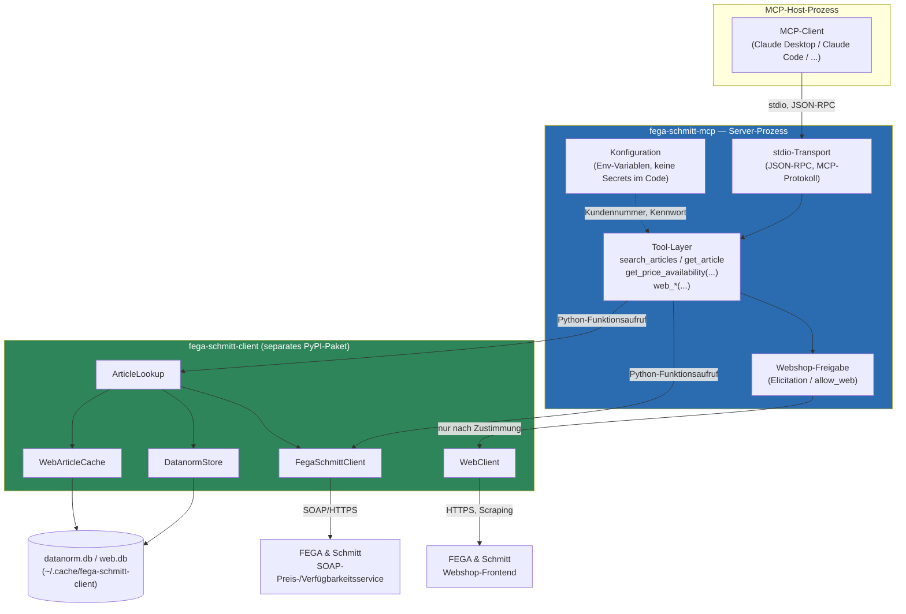
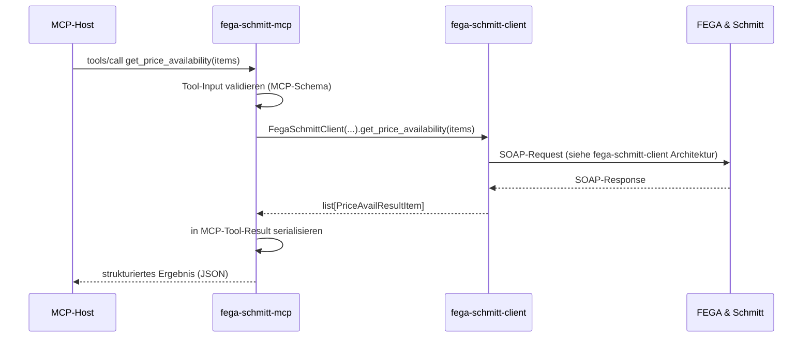
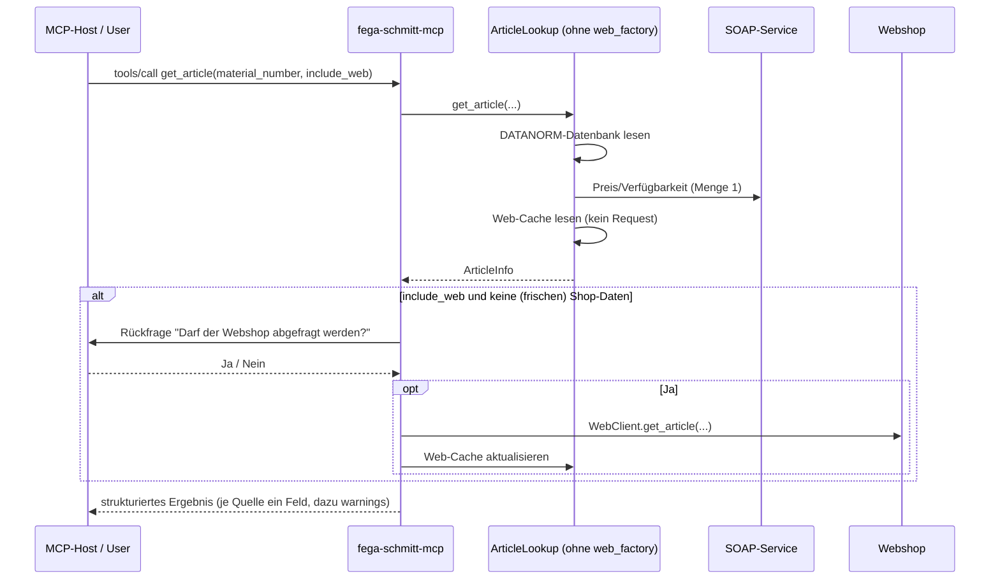
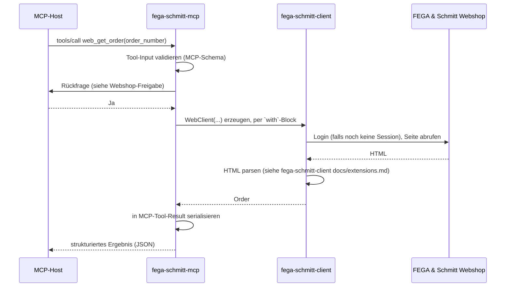

# Architektur

> Artikelsuche und -abfrage (`search_articles`, `get_article`: DATANORM → SOAP → Webshop),
> Preis-/Verfügbarkeitsabfrage (`get_price_availability`, über die SOAP-Schnittstelle) sowie
> Webshop-Zugriff (`web_*`-Tools, über das gescrapte Webshop-Frontend, nur nach Rückfrage beim
> User) implementiert.

## 1. Zuschnitt dieses Repos

`fega-schmitt-mcp` ist bewusst dünn gehalten: Es kennt das MCP-Protokoll (Tools, Schemas, stdio-Transport) und übersetzt Tool-Aufrufe in Aufrufe der Library [`fega-schmitt-client`](../../../Python/fega-schmitt-client). Alles, was FEGA & Schmitt-Protokolldetails betrifft (SOAP, Auth, XML, Returncodes, Datenmodell, Webshop-Scraping), lebt dort — siehe [dessen Architekturbeschreibung](../../../Python/fega-schmitt-client/docs/architecture.md).

Der Server selbst ist zustandslos: Jeder Tool-Aufruf öffnet die Library-Objekte neu und schließt sie wieder (`ArticleLookup`, `WebClient` per `with`-Block). Lokale Daten — DATANORM-Datenbank und Web-Cache — gehören der Library und liegen in deren Cache-Verzeichnis; der Server liest sie und schreibt nur frisch abgerufene Shop-Artikel in den Web-Cache.

## 2. Ablauf `get_price_availability` (SOAP-Tool-Sicht)

Die eigentliche Request-/Response-Logik, das Fehler-/Returncode-Mapping und das Datenmodell sind in der [Architekturbeschreibung von `fega-schmitt-client`](../../../Python/fega-schmitt-client/docs/architecture.md) dokumentiert (Abschnitte 3–5) und werden hier nicht dupliziert.

## 2.1 Ablauf `get_article` (DATANORM → SOAP → Webshop)

Der `ArticleLookup` bekommt bewusst keine `web_factory`: So kann er den Shop nie selbst ansprechen, sondern nur gecachte Seiten liefern. Den Shop-Abruf macht der Server erst nach der Freigabe. `search_articles` funktioniert genauso: zuerst DATANORM, die Webshop-Suche nur ohne Treffer und nach Rückfrage.

### Webshop-Freigabe

`_confirm_web` fragt den User per MCP-Elicitation, sobald der Client die Fähigkeit `elicitation` meldet. Ab Protokoll 2026-07-28 kann der Server während eines Aufrufs keine eigenen Requests mehr an den Client schicken; dort gibt das Tool ein `InputRequiredResult` mit der Frage zurück, und der Client wiederholt den Aufruf mit der Antwort in `input_responses`. Bei älteren Protokollen läuft die Frage über `ctx.elicit()`. Nur Clients ohne Elicitation fallen auf den Parameter `allow_web` zurück, den das Modell erst nach einer Rückfrage im Chat setzen darf. Resolver-Injection (`Resolve(...)`) passt hier nicht, weil Resolver vor dem Tool-Body laufen, ob der Shop gebraucht wird, aber erst nach dem lokalen Lookup feststeht.

## 2.2 Ablauf eines `web_*`-Tools (Webshop-Tool-Sicht)

Anders als bei `get_price_availability` ist die Antwort hier das Ergebnis eines HTML-Parsers gegen eine nicht offiziell dokumentierte Weboberfläche, kein XML-Response gegen eine dokumentierte Schnittstelle — daher potenziell instabiler gegenüber Änderungen bei FEGA & Schmitt. Details je Methode: [`fega-schmitt-client`/docs/extensions.md](../../../Python/fega-schmitt-client/docs/extensions.md).

## 3. Aufgabe dieses Repos im Detail

- **MCP-Tool-Definition**: Name, Beschreibung, Input-/Output-Schema für `search_articles`, `get_article`, `get_price_availability` und die `web_*`-Tools
- **Webshop-Freigabe**: Rückfrage beim User vor jedem Request an den Shop (Abschnitt 2.1)
- **Konfiguration/Secrets**: Einlesen von Zugangsdaten (Kundennummer, Shop-Kennwort, gemeinsam für beide Backends) aus Umgebungsvariablen oder MCP-Client-Konfiguration und Weiterreichen an `FegaSchmittClient`/`WebClient` — die Library selbst liest keine Umgebungsvariablen (siehe deren Architektur, Abschnitt 6)
- **Fehler-Serialisierung**: Exceptions aus `fega-schmitt-client` (`FegaTransportError`, `FegaAuthError`, `FegaLoginError`, `FegaScrapingError`) in MCP-konforme Fehlerantworten übersetzen; Positions-Fehler (`status = "error"` je Artikel) werden als Teil des normalen Tool-Ergebnisses zurückgegeben, nicht als MCP-Fehler
- **Kein** eigenes SOAP-/XML-Handling, kein eigenes DATANORM-Parsing, kein eigenes HTML-Parsing, keine eigene Kopie der FEGA & Schmitt-Spezifikationen (siehe [`fega-schmitt-client`/docs/specs/](../../../Python/fega-schmitt-client/docs/specs/) bzw. [docs/extensions.md](../../../Python/fega-schmitt-client/docs/extensions.md))

## 4. Technologiewahl

- **MCP-Framework:** `MCPServer` (`mcp[cli]` v2, offizielles Python-SDK)
- **Paketverwaltung:** `uv`, Linting/Formatting mit `ruff`
- **Abhängigkeit:** `fega-schmitt-client` (≥ 0.1.0, mit DATANORM und `ArticleLookup`) als reguläre PyPI-Dependency (kein Vendoring, kein Git-Submodule)
- **Tests:** `pytest`, mit gemockten `FegaSchmittClient`/`WebClient`/`DatanormStore` (`_build_client`/`_build_web_client`/`DatanormStore.open` werden gepatcht) und allen Caches in `tmp_path`, damit Server-Tests keine echte SOAP-Verbindung, keine HTTP-Requests gegen den Webshop und keine lokalen Daten brauchen. Die Freigabe wird über einen In-Process-`Client` in beiden Protokollgenerationen getestet (`tests/test_consent.py`)
- **Veröffentlichung:** PyPI, via Trusted Publishing (GitHub Actions)

## 5. Warum IDS und UGL4 hier ohnehin kein Thema sind

Beide Schnittstellen sind kein Request/Response-Muster (Browser-Redirect-Flow bzw. Batch-Datei-Austausch, siehe [`fega-schmitt-client`/docs/architecture.md](../../../Python/fega-schmitt-client/docs/architecture.md), Abschnitt 7). Sollten sie später als Erweiterung der Library folgen, würde dieses Repo lediglich ein weiteres, dünnes Tool ergänzen, das die dann in `fega-schmitt-client.ids` / `fega-schmitt-client.ugl4` liegende Funktion aufruft — die architektonische Rolle dieses Repos (dünner MCP-Wrapper, keine Protokolllogik) ändert sich dadurch nicht. Das `web`-Submodul (Abschnitt 2.1) folgt demselben Muster: Es ist eine dritte, ebenfalls dünn angebundene Datenquelle der Library, kein eigenes Protokoll in diesem Repo.

## 6. Offene Fragen

Siehe README, Abschnitt "Offene Punkte".
